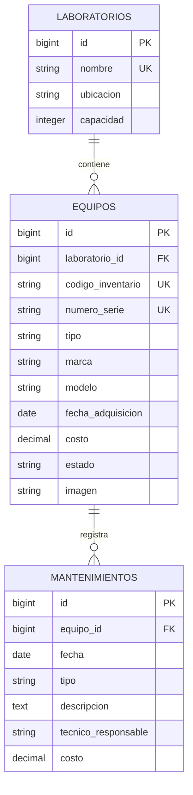

# Inventario de laboratorios de cómputo

## Requisitos

Docker con Compose v2, Git y acceso a Internet para conectar con Supabase.

El contenedor incluye PHP 8.3.35, Composer 2.10.3 y las extensiones pdo_pgsql, pdo_sqlite, intl y zip. La aplicación usa Laravel 13 y PostgreSQL 17 en Supabase.

## Instalación

Clonar el repositorio:

```sh
git clone https://github.com/Solit0/proyecto-final-laravel.git
cd proyecto-final-laravel
cp .env.example .env
```

Completar `DB_PASSWORD` en `.env` con la contraseña compartida por el equipo. La plantilla incluye la conexión al Session pooler de Supabase; conservar `DB_SSLMODE=require`.

```sh
docker compose build app
docker compose run --rm app composer install --no-interaction
docker compose run --rm app php artisan key:generate --no-interaction
docker compose run --rm app php artisan storage:link --no-interaction
docker compose up -d
```

Abrir [http://localhost:8080](http://localhost:8080). Por ahora se muestra la bienvenida de Laravel. Generar la clave solo durante la primera instalación.

En Linux, si el usuario o grupo no tiene ID 1000, ajustar `LOCAL_UID` y `LOCAL_GID` en `.env`. Si el puerto está ocupado, cambiar `APP_PORT` y `APP_URL`.

## Base de datos

Cuando estén integradas las migraciones del negocio, Harry ejecuta una sola vez sobre la base compartida:

```sh
docker compose exec app php artisan migrate --seed --no-interaction
```

Los seeders preparan **3 laboratorios, 15 equipos y 3 mantenimientos**. Conservan equipos existentes y evitan duplicar el historial. Las fechas y estados de los mantenimientos de ejemplo son coherentes con los equipos; esto no sustituye la validación de formularios de Fase 2.

Para reconstruir la base de prueba, únicamente con acuerdo del equipo:

```sh
docker compose exec app php artisan migrate:fresh --seed --no-interaction
```

**Elimina todas las tablas y sus datos.** La reconstrucción con las migraciones definitivas está pendiente de integración.

## Modelo de datos

Un laboratorio tiene muchos equipos; cada equipo pertenece a un laboratorio y tiene muchos mantenimientos. El diagrama representa el esquema acordado, pendiente de contrastar con las migraciones definitivas.



Los códigos de inventario y números de serie son únicos. Los costos usan `decimal(10,2)`; solo la imagen admite null. Las relaciones impiden borrar laboratorios con equipos y equipos con historial.

## Uso y pruebas

```sh
# Iniciar
docker compose up -d

# Detener
docker compose down

# Ejecutar las pruebas
docker compose exec app php artisan test --compact
```

Las pruebas usan SQLite en memoria con un esquema de prueba; no modifican Supabase ni sustituyen la comprobación de las migraciones definitivas.
