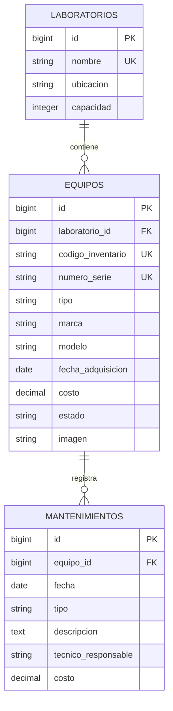

# Inventario de laboratorios de cómputo

Proyecto final de **Desarrollo Web con Software Libre**, Universidad Católica de El Salvador. **Caso 4:** controlar equipos de laboratorios y su historial de mantenimientos.

Repositorio: [Solit0/proyecto-final-laravel](https://github.com/Solit0/proyecto-final-laravel).

## Integrantes y responsabilidades

| Integrante | Usuario de GitHub | Responsabilidad |
|---|---|---|
| Harry | [damian-sh](https://github.com/damian-sh) | Entorno, semillas, documentación; imágenes y reportes en Fase 2 |
| Miguel | Pendiente de confirmar | Migraciones, modelos Laboratorio/Mantenimiento y módulo de mantenimientos |
| David | [Solit0](https://github.com/Solit0) | Modelo Equipo, consultas, rutas y CRUD de equipos |
| Alfredo | [senmontoya](https://github.com/senmontoya) | Layout, vistas, formularios, estilos y capturas |

David es propietario del repositorio. Harry y Alfredo tienen permiso de escritura, comprobado en GitHub; sus perfiles públicos identifican a David Solito y Alfredo Montoya. El usuario de Miguel y el de la docente quedan pendientes por acuerdo del equipo; David debe gestionar las invitaciones pendientes desde la cuenta propietaria. Cada persona debe aportar desde su propia cuenta.

## Estado de esta entrega

Los entregables de entorno, semillas y documentación de Harry están implementados. Su aceptación integrada sigue pendiente de las migraciones, modelos y pantallas del equipo.

| Componente | Estado |
|---|---|
| Laravel 13 en Docker Compose, configuración y PostgreSQL/SSL | Preparado |
| Factory y seeders de 3 laboratorios, 15 equipos y 3 mantenimientos | Implementados y comprobados con contrato de pruebas |
| README de instalación y reparto del trabajo | Preparado |
| Proyecto Supabase | Creado y verificado: inventario-laboratorios, organización idk, región us-east-1 |
| Conexión real desde Laravel | Verificada con PHP 8.3 y pdo_pgsql; Docker incluye las extensiones necesarias |
| Migraciones definitivas y modelos del negocio | Pendientes de Miguel y David |
| Listado, ficha, layout e imagen predeterminada | Pendientes de David y Alfredo |
| Clon completo con listado y ficha | Pendiente de integrar módulos del negocio |
| Colaboradores, aportes en días distintos y etiqueta v1.0 | Pendientes de comprobar/completar con el equipo |

Comprobaciones de Harry realizadas el **4 de noviembre de 2026**:

- [x] Laravel arranca en Docker; `/` y `/up` responden HTTP 200 en el puerto 8080.
- [x] Conexión real a PostgreSQL 17.11 de Supabase desde el contenedor, con `sslmode=require`.
- [x] Factory y seeders: 8 pruebas aprobadas, 534 aserciones; las pruebas usan SQLite en memoria.
- [x] Instalación con Docker ensayada desde una copia limpia, sin PHP ni Composer locales.
- [x] `.env` privado con permisos 600; credenciales, vendor y herramientas de planificación fuera de los archivos versionados.
- [x] Aportes propios con Conventional Commits en los días 3 y 4 de noviembre; se supera el mínimo individual de 3 commits.
- [ ] Aplicar las migraciones definitivas y sembrar la base compartida cuando Miguel y David entreguen sus archivos.
- [ ] Repetir el ensayo completo con listado y ficha cuando David y Alfredo integren sus pantallas.
- [ ] Comprobar las instalaciones de los otros tres integrantes y completar las invitaciones pendientes.

Por ahora `/` muestra la bienvenida original de Laravel y `/up` permite comprobar el arranque. `/equipos` estará disponible cuando David integre sus rutas y controlador. No se crea `v1.0` mientras falten los requisitos del equipo.

Proyecto compartido: [inventario-laboratorios en Supabase](https://supabase.com/dashboard/project/rdwfytkqjlvturwfedbg). Organización **idk**, plan Free; creación autorizada con costo indicado de **US$0 al mes**. Su referencia es `rdwfytkqjlvturwfedbg` y utiliza PostgreSQL 17.11.

Se creó el usuario `laravel_app` para Laravel, sin privilegios de superusuario, creación de bases, creación de roles ni bypass de RLS. Puede conectar y crear las tablas del negocio en public mediante las futuras migraciones de Laravel. El esquema public no permite acceso a PUBLIC, anon ni authenticated; el interruptor Data API del panel no se ha desactivado mediante el conector. No se crearon las tablas del negocio fuera de Laravel.

Fase 1: presentación acordada para el **5 de noviembre de 2026**. Fase 2: **12 de noviembre de 2026**, sobre este mismo repositorio; agregará CRUD completo, formularios, imágenes, reglas y reportes. No se despliega en hosting.

## Requisitos

- Docker Engine con Docker Compose v2 o posterior, o Docker Desktop con Compose.
- Git para clonar el repositorio.
- Acceso a Internet y al proyecto Supabase compartido para consultar los datos del sistema.

El contenedor incluye PHP **8.3.35**, Composer **2.10.3**, PostgreSQL PDO, SQLite PDO, intl y zip, además de las extensiones habituales de Laravel. Todo PHP y Composer se ejecuta dentro de Docker; el único servicio es la aplicación. La base de datos permanece en Supabase. El CSS propio acordado no requiere Node ni npm.

```sh
docker --version
docker compose version
```

## Instalación local con Docker

Mientras el [PR #1](https://github.com/Solit0/proyecto-final-laravel/pull/1) siga en revisión, clonar la rama de trabajo:

```sh
git clone --branch chore/harry-fase-1 https://github.com/Solit0/proyecto-final-laravel.git
cd proyecto-final-laravel
cp .env.example .env
```

Si ya tienes este proyecto y su `.env` privado configurado, conserva ese archivo. En PowerShell se puede reemplazar `cp .env.example .env` por `Copy-Item .env.example .env`.

El `.env.example` ya contiene el Host de **Supabase → Connect → Session pooler** que confirmó el equipo y el usuario exclusivo de Laravel. Completar únicamente la contraseña en el `.env` local, compartida por un canal privado:

```dotenv
DB_CONNECTION=pgsql
DB_HOST=aws-0-us-east-1.pooler.supabase.com
DB_PORT=5432
DB_DATABASE=postgres
DB_USERNAME=laravel_app.rdwfytkqjlvturwfedbg
DB_PASSWORD="CONTRASENA_PRIVADA_DEL_USUARIO_LARAVEL"
DB_SSLMODE=require
```

El Host se copió completo desde Connect; no se construyó a partir de la región. El usuario `laravel_app` reemplaza el usuario administrativo que el panel muestra por defecto. Session pooler permite conexión por IPv4; no confundirlo con Transaction pooler de puerto 6543. Mantener `DB_SSLMODE=require` para Supabase.

Como Supabase se usa únicamente como motor PostgreSQL desde Laravel, se recomienda desactivar **Enable Data API** desde la configuración del proyecto dedicado. El conector ya permitió restringir el acceso al esquema public; no se afirma que haya cambiado ese interruptor del panel. Las tablas del negocio se crean con migraciones de Laravel, nunca con el editor de tablas. La contraseña de Laravel se generó localmente y permanece únicamente en `.env`; no se versiona ni aparece en la documentación.

La configuración usa zona horaria `America/El_Salvador`, sesiones y caché en archivos y cola síncrona. `compose.override.yaml` monta el código del proyecto en `/app`, así que las ediciones se ven en el contenedor y vendor, sesiones e imágenes se conservan en la carpeta local al detenerlo. El `.env` no se copia a la imagen ni se publica en Git.

En Linux, si tu usuario y grupo tienen identificadores distintos a 1000, consultar `id -u` e `id -g` y ajustar `LOCAL_UID` y `LOCAL_GID` en `.env` para que Docker cree archivos con tu usuario. Los valores predeterminados ya corresponden a esta computadora.

Primera instalación, usando únicamente Docker:

```sh
docker compose build app
docker compose run --rm app composer install --no-interaction
docker compose run --rm app php artisan key:generate --no-interaction
docker compose run --rm app php artisan storage:link --no-interaction
docker compose up -d
```

Generar APP_KEY solo al configurar una instalación nueva; en esta computadora ya existe y no se debe regenerar en cada arranque. Ejecutar storage:link dentro del contenedor para que apunte a `/app/storage/app/public`. Si se está migrando una instalación anterior con un enlace creado fuera de Docker, recrearlo una vez con `docker compose run --rm app php artisan storage:link --force --no-interaction`.

Abrir [http://localhost:8080](http://localhost:8080). El contenedor ejecuta `php artisan serve` en el puerto interno 8000 y Docker lo publica únicamente en esta computadora. Por ahora muestra la bienvenida de Laravel. Los seeders no pueden ejecutarse todavía sobre la estructura definitiva porque faltan las migraciones del negocio.

Para los siguientes arranques, basta con `docker compose up -d`. `docker compose ps` muestra el estado y `docker compose logs --tail=50 app` muestra la salida del servidor. Para detenerlo, usar `docker compose down`; no se necesitan opciones que borren volúmenes ni comandos que reinicien Supabase.

Si el puerto 8080 está ocupado, cambiar `APP_PORT` y `APP_URL` en `.env` y ejecutar de nuevo `docker compose up -d`. Al cambiar otras variables de Laravel, ejecutar `docker compose exec app php artisan config:clear`.

### Cuando Miguel entregue las migraciones definitivas

Harry coordina su aplicación una sola vez sobre la base compartida:

```sh
docker compose exec app php artisan migrate --seed --no-interaction
```

Los demás integrantes actualizan el repositorio y consultan esa misma base; no deben ejecutar migraciones o seeders de forma simultánea. `DatabaseSeeder` informa claramente si falta una de las tablas del negocio antes de insertar datos. Las filas de ejemplo se conservan al repetir los seeders: códigos existentes no se sobrescriben y los mantenimientos de ejemplo no se duplican.

Antes de ejecutar ese comando, deben estar integradas las migraciones de `laboratorios`, `equipos` y `mantenimientos`, los modelos con sus relaciones y la conexión de `Equipo` con `EquipoFactory`. Después, comprobar los datos esperados: **3 laboratorios, 15 equipos y 3 mantenimientos** en una base vacía. Si hay datos anteriores, no reiniciar la base para forzar esos totales. Abrir `/equipos`, cambiar de página y consultar una ficha con laboratorio e historial; repetir la instalación con los cuatro integrantes. Este ensayo pendiente es el que cierra la aceptación de las semillas y del README de Harry.

### Reinicio exclusivo de datos de prueba

Solo Harry, después de acordarlo con el equipo y confirmar que se pueden perder todos los datos del proyecto dedicado, utiliza:

```sh
docker compose exec app php artisan migrate:fresh --seed --no-interaction
```

Este comando elimina tablas y datos. Es una demostración obligatoria de la Fase 1 completa, pero **todavía no se ha verificado contra las migraciones definitivas ni contra Supabase**. No ejecutarlo como parte de cada instalación o actualización de un compañero.

## Modelo de datos acordado

El siguiente diagrama es el contrato de integración; Miguel debe contrastarlo con sus migraciones reales antes de dar por terminado este criterio.



El contrato acordado usa código de inventario de 8 caracteres, marca/modelo/serie de hasta 100, nombre de laboratorio de hasta 100, ubicación y técnico de hasta 150, fechas de tipo date y costos decimal(10,2) no negativos. Capacidad es un entero positivo; solo imagen admite null entre los campos del negocio. Se acordó impedir borrar laboratorios con equipos y equipos con historial usando FK con `restrictOnDelete`. Un equipo con historial se puede marcar de baja.

## Datos de prueba y reglas

Los seeders ejecutan catálogos → equipos → mantenimientos dentro de una transacción. La factory genera identificadores únicos, adquisiciones pasadas y costos no negativos. Se generan equipos de los cuatro tipos y los tres estados, sin fotografías subidas.

`EquipoFactory::new()->raw()` permite comprobar las semillas con Query Builder antes de integrar el modelo Equipo de David; cuando exista ese modelo, su factory también podrá utilizar las operaciones Eloquent habituales.

El historial de ejemplo respeta adquisición y estado; un correctivo nuevo cambia el equipo a reparación. Esto **solo prepara datos de prueba**: los Form Requests y reglas de las operaciones del usuario pertenecen a Fase 2 y siguen pendientes.

| Regla obligatoria para Fase 2 | Responsable y ubicación prevista |
|---|---|
| Código LAB-0000 y serie únicos, costo no negativo, adquisición no futura | David: StoreEquipoRequest y UpdateEquipoRequest; migraciones de Miguel |
| Mantenimiento posterior o igual a adquisición y equipo no dado de baja | Miguel: StoreMantenimientoRequest y MantenimientoController |
| Correctivo cambia a en reparación de forma atómica | Miguel: transacción en MantenimientoController |
| Archivos JPG/PNG/WebP de hasta 2 MB y limpieza segura | Harry, integrado con requests y controlador de David |
| Costo total, distribución y falta de mantenimiento en el último año | Harry: PanelController y reporte |

## Pruebas

```sh
docker compose exec app php artisan test --compact
```

Las pruebas ordinarias fuerzan SQLite en memoria y anulan DB_URL; no leen ni limpian Supabase. Las tablas de `tests/Fixtures/migrations` son un contrato temporal, fuera de `database/migrations`: **no son las migraciones de entrega de Miguel** y no deben ejecutarse en la base compartida.

Se verifican arranque, datos mínimos, identificadores, fechas, repetición sin duplicados, conservación de equipos editados, rechazo de estructura incompleta, rollback de semillas y exclusión de equipos dados de baja.

Validación de esta entrega: imagen construida, servicio saludable, HTTP 200 en `/` y `/up`, e instalación con Docker probada desde una copia limpia sin vendor. Las 8 pruebas pasaron con PHP 8.3 tanto en el proyecto como en esa copia. Además, seeders comprobados dos veces sobre PostgreSQL 16 aislado con fixtures, obteniendo 3 laboratorios, 15 equipos, 3 mantenimientos y cero mantenimientos inválidos. La conexión real a Supabase se comprobó desde el servicio de Compose mediante Laravel con `sslmode=require`, base postgres y rol laravel_app. El chequeo de seguridad de Supabase no reportó avisos. El ensayo completo de listado/ficha sigue pendiente de los módulos del equipo.

Para volver a comprobar la conexión, con el contenedor iniciado y el `.env` privado configurado:

```sh
docker compose exec app php artisan db:show --database=pgsql --json --no-interaction
```

La salida identifica la conexión y base de datos; no necesita mostrar contraseñas. Las pruebas del inventario continúan aisladas de la base compartida. Para comprobar las herramientas incluidas: `docker compose exec app php -v` y `docker compose exec app composer --version`.

## Organización, Git y entregas

- Harry: entorno, configuración, factory/seeders, pruebas y documentación de esta entrega.
- Miguel: migraciones definitivas, Laboratorio/Mantenimiento y diagrama validado; mantenimientos en Fase 2.
- David: modelo Equipo, consultas y rutas; CRUD y filtros en Fase 2.
- Alfredo: layout, listado, ficha e inicio; formularios, mensajes, móvil y capturas en Fase 2.

Cada integrante debe mantener autoría real, usar Conventional Commits y trabajar en ramas con pull requests. Fase 1 exige al menos 12 commits, 3 por persona, en 2 días distintos; Fase 2 exige al menos 20 adicionales, 5 por persona, en 3 días distintos. Crear varios commits hoy no sustituye el requisito de días distintos. Las etiquetas corresponden al sistema completo, no a una sola persona.

Las capturas de pantallas del negocio se agregarán tras integrar las vistas. Las etiquetas [CONCEPTO] se colocan como comentarios en el código real que demuestra cada concepto, no como una lista que simule implementación.

## Cambios respecto a Fase 1

No aplica todavía: no se ha cerrado v1.0. Después de esa etiqueta, los cambios de esquema se harán mediante migraciones nuevas y se explicarán aquí.

## Referencias

- [Laravel 13](https://laravel.com/docs/13.x)
- [Docker Compose](https://docs.docker.com/compose/)
- [Conexión PostgreSQL de Supabase](https://supabase.com/docs/guides/database/connecting-to-postgres)
- [Seguridad de la Data API](https://supabase.com/docs/guides/api/securing-your-api)
