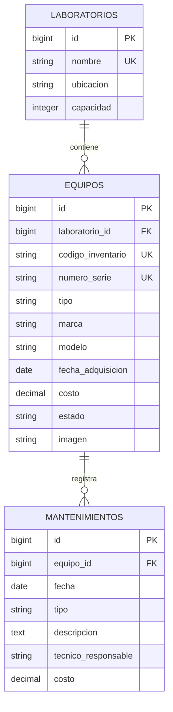

# Inventario de laboratorios de cómputo

## Requisitos

Docker con Compose v2, Git y acceso a Internet para conectar con Supabase.

El contenedor incluye PHP 8.3.35, Composer 2.10.3 y las extensiones pdo_pgsql, pdo_sqlite, intl y zip. La aplicación usa Laravel 13 y PostgreSQL 17 en Supabase.

## Instalación

Clonar el repositorio:

```sh
git clone https://github.com/Solit0/proyecto-final-laravel.git
cd proyecto-final-laravel
cp .env.example .env
```

Completar `DB_PASSWORD` en `.env` con la contraseña compartida por el equipo. La plantilla incluye la conexión al Session pooler de Supabase; conservar `DB_SSLMODE=require`.

```sh
docker compose build app
docker compose run --rm app composer install --no-interaction
docker compose run --rm app php artisan key:generate --no-interaction
docker compose run --rm app php artisan storage:link --no-interaction
docker compose up -d
```

Abrir [http://localhost:8080](http://localhost:8080). Por ahora se muestra la bienvenida de Laravel. Generar la clave solo durante la primera instalación.

En Linux, si el usuario o grupo no tiene ID 1000, ajustar `LOCAL_UID` y `LOCAL_GID` en `.env`. Si el puerto está ocupado, cambiar `APP_PORT` y `APP_URL`.

## Base de datos

Con las migraciones del negocio integradas en `database/migrations`, Harry ejecuta una sola vez sobre la base compartida:

```sh
docker compose exec app php artisan migrate --seed --no-interaction
```

Los seeders preparan **3 laboratorios, 15 equipos y 3 mantenimientos**. Conservan equipos existentes y evitan duplicar el historial. Las fechas y estados de los mantenimientos de ejemplo son coherentes con los equipos; esto no sustituye la validación de formularios de Fase 2.

Para reconstruir la base de prueba, únicamente con acuerdo del equipo:

```sh
docker compose exec app php artisan migrate:fresh --seed --no-interaction
```

**Elimina todas las tablas y sus datos.** La reconstrucción debe coordinarse con todo el equipo porque afecta la base compartida.

## Modelo de datos

Un laboratorio tiene muchos equipos; cada equipo pertenece a un laboratorio y tiene muchos mantenimientos. El diagrama representa el esquema que crean las migraciones y que describen los modelos.



Los códigos de inventario y números de serie son únicos. Los costos usan `decimal(10,2)`; solo la imagen admite null. Las relaciones impiden borrar laboratorios con equipos y equipos con historial.

### Diccionario y restricciones

| Tabla | Propósito | Restricciones principales |
|---|---|---|
| `laboratorios` | Catálogo de espacios de cómputo. | `nombre` único; `capacidad` mayor que cero mediante CHECK en PostgreSQL. |
| `equipos` | Bienes asignados a un laboratorio. | `codigo_inventario` y `numero_serie` únicos; `costo` no negativo mediante CHECK; `estado` inicia en `operativo`; solo `imagen` es nullable. |
| `mantenimientos` | Historial de trabajos por equipo. | `costo` no negativo mediante CHECK; `tipo` limitado a `preventivo` o `correctivo`. |

Las claves foráneas usan `restrictOnDelete`: no se puede borrar un laboratorio que todavía tiene equipos ni un equipo con mantenimientos, para no perder historial ni dejar registros huérfanos. Las tablas del negocio se crean únicamente mediante migraciones.

## Módulo de mantenimientos

| Método | URL | Nombre | Acción |
|---|---|---|---|
| GET | `/mantenimientos` | `mantenimientos.index` | Listado paginado, más reciente primero. |
| GET | `/mantenimientos/create` | `mantenimientos.create` | Formulario; excluye equipos dados de baja. |
| POST | `/mantenimientos` | `mantenimientos.store` | Registro validado dentro de una transacción. |

Reglas principales:

- La fecha no puede ser anterior a la fecha de adquisición del equipo; se permiten fechas iguales o futuras.
- Un equipo dado de baja no admite mantenimientos, aunque se manipule el POST.
- El estado y la fecha se vuelven a comprobar con la fila del equipo bloqueada antes de insertar.
- Un mantenimiento preventivo conserva el estado del equipo.
- Un mantenimiento correctivo cambia el equipo a `en_reparacion` dentro de la misma transacción; si falla una escritura, se revierten ambas.
- No existe una operación automática para devolver el equipo a `operativo`.

Las pruebas del módulo están en `tests/Feature/MantenimientoTest.php`. Usan SQLite en memoria, ejecutan las migraciones reales y envuelven cada caso en una transacción con rollback, sin tocar Supabase ni usar `RefreshDatabase`.

## Uso y pruebas

```sh
# Iniciar
docker compose up -d

# Detener
docker compose down

# Ejecutar las pruebas
docker compose exec app php artisan test --compact
```

Las pruebas usan SQLite en memoria y no modifican Supabase: el módulo de mantenimientos ejecuta las migraciones reales, mientras que las pruebas de seeders usan el contrato de `tests/Fixtures`.
