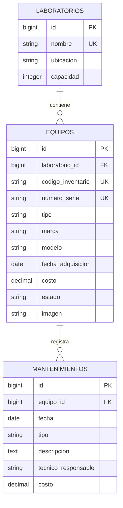

# Inventario de laboratorios de cómputo

Proyecto final de **Desarrollo Web con Software Libre**, Universidad Católica de El Salvador. **Caso 4:** controlar equipos de laboratorios y su historial de mantenimientos.

Repositorio: [Solit0/proyecto-final-laravel](https://github.com/Solit0/proyecto-final-laravel).

## Integrantes y responsabilidades

| Integrante | Usuario de GitHub | Responsabilidad |
|---|---|---|
| Harry | [damian-sh](https://github.com/damian-sh) | Entorno, semillas, documentación; imágenes y reportes en Fase 2 |
| Miguel | Pendiente de confirmar | Migraciones, modelos Laboratorio/Mantenimiento y módulo de mantenimientos |
| David | Pendiente de confirmar | Modelo Equipo, consultas, rutas y CRUD de equipos |
| Alfredo | Pendiente de confirmar | Layout, vistas, formularios, estilos y capturas |

El propietario del repositorio es Solit0; no se presupone a qué integrante corresponde esa cuenta. Cada persona debe confirmar su usuario y aportar desde su propia cuenta. La invitación de la docente y los demás colaboradores debe comprobarse en GitHub.

## Estado de esta entrega

Esta es la **base de la Fase 1 de Harry**, no la Fase 1 completa del equipo.

| Componente | Estado |
|---|---|
| Laravel 13, configuración local y ejemplo PostgreSQL/SSL | Preparado |
| Factory y seeders de 3 laboratorios, 15 equipos y 3 mantenimientos | Implementados y comprobados con contrato de pruebas |
| README y planificación con Spec Kit | Preparados |
| Proyecto Supabase | Creado y verificado: inventario-laboratorios, organización idk, región us-east-1 |
| Conexión real desde Laravel | Verificada con PHP 8.3 y pdo_pgsql en el entorno de verificación; falta habilitar pdo_pgsql en el PHP del sistema |
| Migraciones definitivas y modelos del negocio | Pendientes de Miguel y David |
| Listado, ficha, layout e imagen predeterminada | Pendientes de David y Alfredo |
| Clon completo con listado y ficha | Pendiente de integrar módulos del negocio |
| Colaboradores, aportes en días distintos y etiqueta v1.0 | Pendientes de comprobar/completar con el equipo |

Por ahora `/` muestra la bienvenida original de Laravel y `/up` permite comprobar el arranque. `/equipos` estará disponible cuando David integre sus rutas y controlador. No se crea `v1.0` mientras falten los requisitos del equipo.

Proyecto compartido: [inventario-laboratorios en Supabase](https://supabase.com/dashboard/project/rdwfytkqjlvturwfedbg). Organización **idk**, plan Free; creación autorizada con costo indicado de **US$0 al mes**. Su referencia es `rdwfytkqjlvturwfedbg` y utiliza PostgreSQL 17.11.

Se creó el usuario `laravel_app` para Laravel, sin privilegios de superusuario, creación de bases, creación de roles ni bypass de RLS. Puede conectar y crear las tablas del negocio en public mediante las futuras migraciones de Laravel. El esquema public no permite acceso a PUBLIC, anon ni authenticated; el interruptor Data API del panel no se ha desactivado mediante el conector. No se crearon las tablas del negocio fuera de Laravel.

Fase 1: presentación acordada para el **5 de noviembre de 2026**. Fase 2: **12 de noviembre de 2026**, sobre este mismo repositorio; agregará CRUD completo, formularios, imágenes, reglas y reportes. No se despliega en hosting.

## Requisitos

- PHP **8.3 o superior**, Composer 2 y extensiones habituales de Laravel: PDO, mbstring, XML/DOM, ctype, curl, fileinfo, openssl y tokenizer.
- **pdo_pgsql** habilitado para Supabase; **pdo_sqlite** para ejecutar las pruebas aisladas.
- Acceso a Internet y al proyecto Supabase compartido para consultar los datos del sistema.
- Git. Node y npm no son necesarios para el CSS propio acordado; el scaffold conserva archivos Vite sin requerir compilación para su bienvenida inicial.

```sh
php -v
composer --version
php --ini
php -m
```

`php -m` debe mostrar `pdo_pgsql`. En XAMPP/Laragon, habilitar la extensión en el php.ini usado por la consola. En Arch Linux, instalar `php-pgsql` y habilitar `extension=pdo_pgsql` en el archivo de configuración indicado por `php --ini`; para pruebas instalar/habilitar también `php-sqlite` y `extension=pdo_sqlite`. La habilitación del PHP del sistema puede requerir permisos de administrador.

## Instalación local

```sh
git clone https://github.com/Solit0/proyecto-final-laravel.git
cd proyecto-final-laravel
composer install
cp .env.example .env
php artisan key:generate --no-interaction
```

En PowerShell se puede reemplazar `cp .env.example .env` por `Copy-Item .env.example .env`.

El `.env.example` ya contiene el Host de **Supabase → Connect → Session pooler** que confirmó el equipo y el usuario exclusivo de Laravel. Completar únicamente la contraseña en el `.env` local, compartida por un canal privado:

```dotenv
DB_CONNECTION=pgsql
DB_HOST=aws-0-us-east-1.pooler.supabase.com
DB_PORT=5432
DB_DATABASE=postgres
DB_USERNAME=laravel_app.rdwfytkqjlvturwfedbg
DB_PASSWORD="CONTRASENA_PRIVADA_DEL_USUARIO_LARAVEL"
DB_SSLMODE=require
```

El Host se copió completo desde Connect; no se construyó a partir de la región. El usuario `laravel_app` reemplaza el usuario administrativo que el panel muestra por defecto. Session pooler permite conexión por IPv4; no confundirlo con Transaction pooler de puerto 6543. Mantener `DB_SSLMODE=require` para Supabase.

Como Supabase se usa únicamente como motor PostgreSQL desde Laravel, se recomienda desactivar **Enable Data API** desde la configuración del proyecto dedicado. El conector ya permitió restringir el acceso al esquema public; no se afirma que haya cambiado ese interruptor del panel. Las tablas del negocio se crean con migraciones de Laravel, nunca con el editor de tablas. La contraseña de Laravel se generó localmente y permanece únicamente en `.env`; no se versiona ni aparece en la documentación.

La configuración local usa zona horaria `America/El_Salvador`, sesiones y caché en archivos y cola síncrona. No requiere Redis ni procesos de colas.

```sh
php artisan config:clear
php artisan storage:link --no-interaction
php artisan serve
```

Abrir [http://localhost:8000](http://localhost:8000). Esto permite comprobar la bienvenida de Laravel sin consultar tablas del negocio. Los seeders no pueden ejecutarse todavía sobre la estructura definitiva porque faltan esas migraciones.

### Cuando Miguel entregue las migraciones definitivas

Harry coordina su aplicación una sola vez sobre la base compartida:

```sh
php artisan migrate --seed --no-interaction
```

Los demás integrantes actualizan el repositorio y consultan esa misma base; no deben ejecutar migraciones o seeders de forma simultánea. `DatabaseSeeder` informa claramente si falta una de las tablas del negocio antes de insertar datos. Las filas de ejemplo se conservan al repetir los seeders: códigos existentes no se sobrescriben y los mantenimientos de ejemplo no se duplican.

### Reinicio exclusivo de datos de prueba

Solo Harry, después de acordarlo con el equipo y confirmar que se pueden perder todos los datos del proyecto dedicado, utiliza:

```sh
php artisan migrate:fresh --seed --no-interaction
```

Este comando elimina tablas y datos. Es una demostración obligatoria de la Fase 1 completa, pero **todavía no se ha verificado contra las migraciones definitivas ni contra Supabase**. No ejecutarlo como parte de cada instalación o actualización de un compañero.

## Modelo de datos acordado

El siguiente diagrama es el contrato de integración; Miguel debe contrastarlo con sus migraciones reales antes de dar por terminado este criterio.



Detalles, longitudes, valores y relaciones: [data-model.md](specs/001-inventario-laboratorios/data-model.md). Se acordó impedir borrar laboratorios con equipos y equipos con historial usando FK con `restrictOnDelete`. Un equipo con historial se puede marcar de baja.

## Datos de prueba y reglas

Los seeders ejecutan catálogos → equipos → mantenimientos dentro de una transacción. La factory genera identificadores únicos, adquisiciones pasadas y costos no negativos. Se generan equipos de los cuatro tipos y los tres estados, sin fotografías subidas.

`EquipoFactory::new()->raw()` permite comprobar las semillas con Query Builder antes de integrar el modelo Equipo de David; cuando exista ese modelo, su factory también podrá utilizar las operaciones Eloquent habituales.

El historial de ejemplo respeta adquisición y estado; un correctivo nuevo cambia el equipo a reparación. Esto **solo prepara datos de prueba**: los Form Requests y reglas de las operaciones del usuario pertenecen a Fase 2 y siguen pendientes.

| Regla obligatoria para Fase 2 | Responsable y ubicación prevista |
|---|---|
| Código LAB-0000 y serie únicos, costo no negativo, adquisición no futura | David: StoreEquipoRequest y UpdateEquipoRequest; migraciones de Miguel |
| Mantenimiento posterior o igual a adquisición y equipo no dado de baja | Miguel: StoreMantenimientoRequest y MantenimientoController |
| Correctivo cambia a en reparación de forma atómica | Miguel: transacción en MantenimientoController |
| Archivos JPG/PNG/WebP de hasta 2 MB y limpieza segura | Harry, integrado con requests y controlador de David |
| Costo total, distribución y falta de mantenimiento en el último año | Harry: PanelController y reporte |

## Pruebas

```sh
php artisan test --compact
```

Las pruebas ordinarias fuerzan SQLite en memoria y anulan DB_URL; no leen ni limpian Supabase. Las tablas de `tests/Fixtures/migrations` son un contrato temporal, fuera de `database/migrations`: **no son las migraciones de entrega de Miguel** y no deben ejecutarse en la base compartida.

Se verifican arranque, datos mínimos, identificadores, fechas, repetición sin duplicados, conservación de equipos editados, rechazo de estructura incompleta, rollback de semillas y exclusión de equipos dados de baja.

Validación de esta entrega: PHP 8.3, 8 pruebas pasadas; además, seeders comprobados dos veces sobre PostgreSQL 16 aislado con fixtures, obteniendo 3 laboratorios, 15 equipos, 3 mantenimientos y cero mantenimientos inválidos. La conexión real a Supabase se comprobó mediante Laravel con `sslmode=require`, base postgres y rol laravel_app. El chequeo de seguridad de Supabase no reportó avisos. El ensayo completo de listado/ficha sigue pendiente de los módulos del equipo.

Para volver a comprobar la conexión, después de habilitar pdo_pgsql y configurar el `.env` privado:

```sh
php artisan db:show --database=pgsql --json --no-interaction
```

La salida JSON evita que esta comprobación requiera la extensión intl para formatear tamaños. Las pruebas del inventario continúan aisladas de la base compartida.

## Organización, Git y entregas

- Harry: entorno, configuración, factory/seeders, pruebas y documentación de esta entrega.
- Miguel: migraciones definitivas, Laboratorio/Mantenimiento y diagrama validado; mantenimientos en Fase 2.
- David: modelo Equipo, consultas y rutas; CRUD y filtros en Fase 2.
- Alfredo: layout, listado, ficha e inicio; formularios, mensajes, móvil y capturas en Fase 2.

Cada integrante debe mantener autoría real, usar Conventional Commits y trabajar en ramas con pull requests. Fase 1 exige al menos 12 commits, 3 por persona, en 2 días distintos; Fase 2 exige al menos 20 adicionales, 5 por persona, en 3 días distintos. Crear varios commits hoy no sustituye el requisito de días distintos. Las etiquetas corresponden al sistema completo, no a una sola persona.

Constitución: [.specify/memory/constitution.md](.specify/memory/constitution.md). Especificación: [spec.md](specs/001-inventario-laboratorios/spec.md). Plan: [plan.md](specs/001-inventario-laboratorios/plan.md). Pendientes y responsables: [tasks.md](specs/001-inventario-laboratorios/tasks.md).

Spec Kit está inicializado con integración Codex; no hace falta instalarlo para ejecutar Laravel. Sus instrucciones de trabajo están en `.agents/skills` y su configuración en `.specify`.

Las capturas de pantallas del negocio se agregarán tras integrar las vistas. Las etiquetas [CONCEPTO] se colocan como comentarios en el código real que demuestra cada concepto, no como una lista que simule implementación.

## Cambios respecto a Fase 1

No aplica todavía: no se ha cerrado v1.0. Después de esa etiqueta, los cambios de esquema se harán mediante migraciones nuevas y se explicarán aquí.

## Referencias

- [Laravel 13](https://laravel.com/docs/13.x)
- [Conexión PostgreSQL de Supabase](https://supabase.com/docs/guides/database/connecting-to-postgres)
- [Seguridad de la Data API](https://supabase.com/docs/guides/api/securing-your-api)
- [Spec Kit](https://github.com/github/spec-kit)
