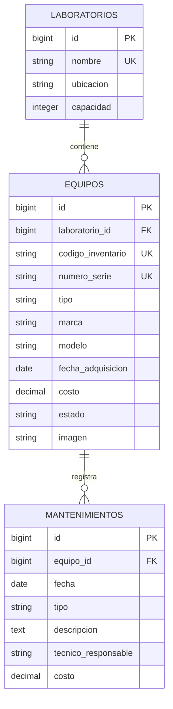
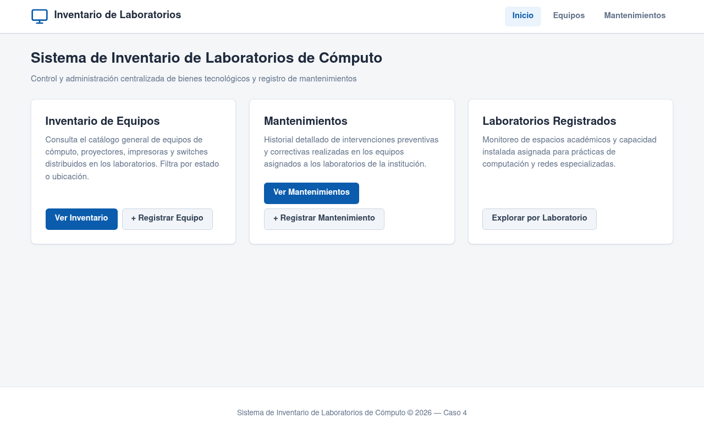
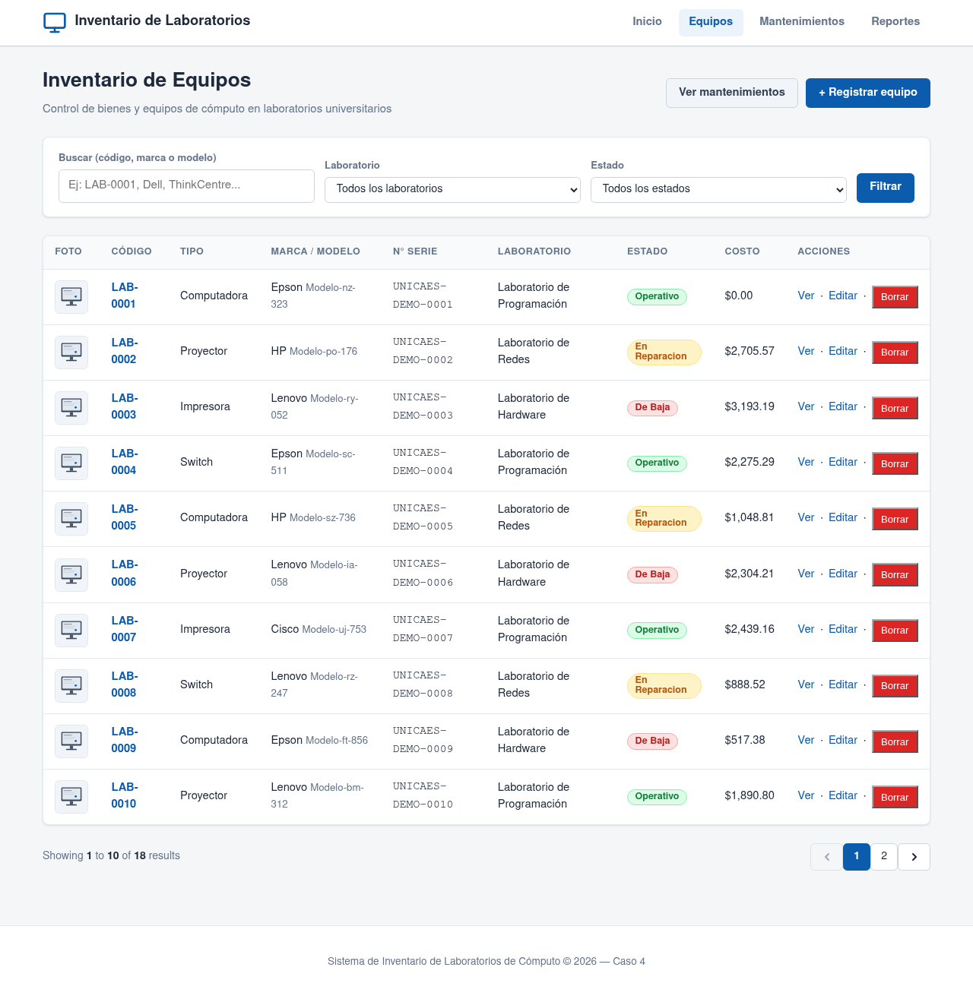
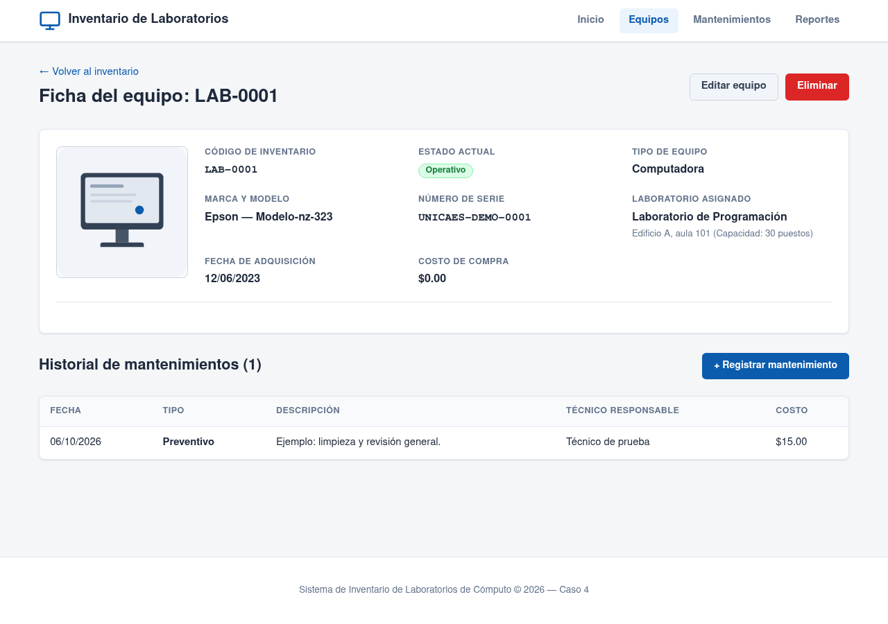

# Inventario de laboratorios de cómputo

**Caso 4 · Desarrollo Web con Software Libre · Universidad Católica de El Salvador.**

Sistema para consultar los equipos de cada laboratorio, su estado y su historial de mantenimientos.

- **Fase 1:** migraciones, modelos y relaciones, datos de prueba, listado paginado y ficha de equipos.
- **Fase 2:** CRUD, búsqueda, validación, imágenes y reportes. Ya se adelantaron formularios, filtros y mantenimientos; falta completar los reportes y la gestión segura de imágenes ante fallos.

## Equipo y aportes

| Integrante | GitHub | Trabajo desarrollado |
|---|---|---|
| Harry | [damian-sh](https://github.com/damian-sh) | Laravel y Docker, conexión a Supabase, factory y seeders, pruebas de semillas e integración y documentación. |
| Miguel Reyes | [mglreyes25](https://github.com/mglreyes25) | Migraciones, modelos Laboratorio/Mantenimiento, validación y registro de mantenimientos y sus pruebas. |
| David Solito | [Solit0](https://github.com/Solit0) | Modelo Equipo, rutas, listado y ficha, CRUD, filtros y pruebas de equipos. |
| Alfredo Montoya | [senmontoya](https://github.com/senmontoya) | Layout, vistas, formularios, estilos, adaptación móvil, capturas y pruebas de vistas. |

## Requisitos

Docker con Compose v2, Git e Internet para conectar con Supabase. El contenedor incluye **PHP 8.3.35**, **Composer 2.10.3** y las extensiones pdo_pgsql, pdo_sqlite, intl, zip y gd. La aplicación usa **Laravel 13** y **PostgreSQL 17 en Supabase**; no requiere instalar PHP, Composer ni Node en el sistema.

## Primera instalación

```sh
git clone https://github.com/Solit0/proyecto-final-laravel.git
cd proyecto-final-laravel
cp .env.example .env
```

Completar `DB_PASSWORD` en el `.env` privado con la contraseña del equipo. La plantilla incluye la conexión al Session pooler de Supabase; conservar `DB_SSLMODE=require`. Si ya existe una instalación configurada, usar los comandos de arranque de la siguiente sección.

```sh
docker compose build app
docker compose run --rm app composer install --no-interaction
docker compose run --rm app php artisan key:generate --no-interaction
docker compose run --rm app php artisan storage:link --no-interaction
docker compose up -d --wait --wait-timeout 60
```

Generar la clave solo al configurar una instalación nueva. En Linux, si el usuario o grupo no tiene ID 1000, ajustar `LOCAL_UID` y `LOCAL_GID` en `.env`. Si el puerto está ocupado, cambiar `APP_PORT` y `APP_URL`.

La base compartida ya tiene sus migraciones y datos de ejemplo. Cuando haya nuevas migraciones, Harry coordina su aplicación con el equipo:

```sh
docker compose exec app php artisan migrate --seed --no-interaction
```

## Arranque y pruebas

Desde la carpeta del proyecto:

```sh
docker compose up -d --wait --wait-timeout 60
docker compose ps
```

Abrir [http://localhost:8080](http://localhost:8080). Desde el inicio se accede al [inventario](http://localhost:8080/equipos) y a los [mantenimientos](http://localhost:8080/mantenimientos). El servidor `php artisan serve` corre dentro de Docker; la base permanece en Supabase.

```sh
# Ejecutar pruebas aisladas de la base compartida
docker compose exec app php artisan test --compact

# Detener el servidor local
docker compose down
```

Las pruebas usan SQLite en memoria. Las de equipos, mantenimientos y vistas ejecutan las migraciones reales; las de seeders usan el contrato de `tests/Fixtures`.

## Datos de prueba

Los seeders preparan **3 laboratorios, 15 equipos y 3 mantenimientos**, en ese orden y dentro de una transacción. La factory genera atributos de equipos; los seeders conservan los equipos existentes y evitan duplicar el historial al repetirse.

Para reconstruir la base de prueba durante la demostración, únicamente después de acordarlo con el equipo:

```sh
docker compose exec app php artisan migrate:fresh --seed --no-interaction
```

**Este comando elimina las tablas y sus datos.** No es necesario para arrancar ni para instalar otra computadora conectada a la misma base.

## Modelo de datos

Un laboratorio tiene muchos equipos. Cada equipo pertenece a un laboratorio y tiene muchos mantenimientos; cada mantenimiento pertenece a un equipo.



| Tabla | Restricciones principales |
|---|---|
| `laboratorios` | Nombre único y capacidad positiva. |
| `equipos` | Código y serie únicos; costo `decimal(10,2)` no negativo; estado inicial `operativo`; imagen opcional. |
| `mantenimientos` | Equipo obligatorio, tipo preventivo/correctivo y costo `decimal(10,2)` no negativo. |

Las migraciones están en `database/migrations`. Las claves foráneas usan `restrictOnDelete` para conservar el historial. Los modelos definen `$fillable`, casts y las relaciones en ambos sentidos.

## Reglas implementadas

| Regla | Ubicación |
|---|---|
| Código `LAB-0000` y serie únicos, adquisición no futura y costo no negativo. | `StoreEquipoRequest`, `UpdateEquipoRequest` y restricciones de las migraciones. |
| Un mantenimiento no puede ser anterior a la adquisición ni corresponder a un equipo de baja. | `StoreMantenimientoRequest` y `MantenimientoController`. |
| Registrar un correctivo deja el equipo en reparación dentro de la misma transacción. | `MantenimientoController::store`. |
| No se puede borrar un equipo con historial ni mover su adquisición después del primer mantenimiento. | `EquipoController::destroy` y `update`; claves foráneas. |
| Imagen opcional JPG/PNG/WebP de hasta 2 MB. | Requests de equipos; falta completar la recuperación de archivos ante fallos de escritura. |

Las etiquetas `[MIGRACION]`, `[RELACION]`, `[ENCAPSULAMIENTO]` y `[CRUD-READ]` aparecen en las migraciones, modelos y métodos de consulta correspondientes.

## Capturas

**Inicio**



**Listado de equipos**



**Ficha del equipo**



También están disponibles las [capturas de formularios, validaciones, mantenimientos y vista móvil](docs/capturas).
